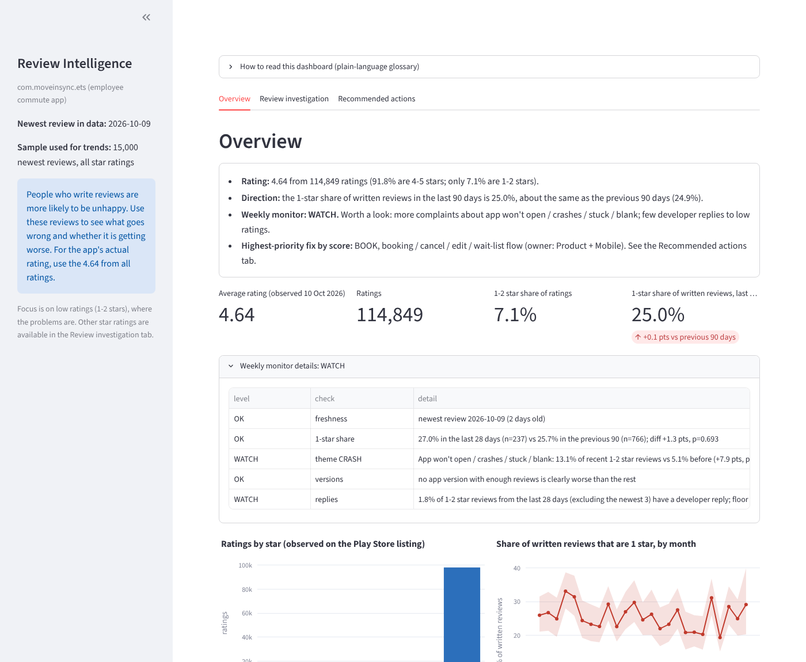

# MoveInSync Play Store ratings: analysis and weekly monitor

Case study on MoveInSync's Play Store ratings. It answers "why are our Play Store ratings
lower than they should be, and what do we fix first?" for the employee commute app
`com.moveinsync.ets`, and can be re-run every week to answer "how are our ratings?".

Data collected 10 Oct 2026 (UTC). All reviews are public Play Store reviews. The peer-app benchmark in the report
was read from public Play Store listings on 11 Oct 2026.

**Scope:** `com.moveinsync.ets` is the employee commute app and the only employee-facing commute app MoveInSync lists
on Google Play. Its other listings (Field app, Driver Onboarding, Workplace kiosk) serve admins, drivers and offices and
have far fewer reviews, so they are not analysed.

**Peer benchmark (read from public Play Store listings on 11 Oct 2026, rounded as Google displays them; peers are
employee-commute apps found in Play Store searches, not a complete list):**

| App (package) | Rating shown | Ratings or reviews | Last updated |
| --- | --- | --- | --- |
| MoveInSync (`com.moveinsync.ets`) | 4.64 (shows 4.6) | 114,849 ratings (10 Oct) | 31 Aug 2026 |
| Routematic (`com.routematic.employee`) | 4.3 | 34.2K reviews | 3 Aug 2026 |
| Shuttl (`app.goplus.in.myapplication`) | 3.0 | 45.5K reviews | 26 Apr 2024 |
| SMT Employee (`in.smarttransport.emp`) | 2.6 | 834 reviews | 29 Aug 2026 |
| Shuttles by Safetrax (`in.mtap.iincube.safetrax.shuttles`) | 4.7 | 242 reviews | 19 Sep 2024 |

The rating is not low against these peers; the remaining gap is the 7.1% of ratings at 1-2 stars and satisfied users
who never rate. The report therefore also recommends the fastest lever on the number: asking satisfied users to rate
with Google's In-App Review API (not scored, because its effect cannot be measured from reviews).

**Live dashboard:** https://moveinsync-ratings-eke9bgfopynnzgijenynmb.streamlit.app/



## What is in the box

| Part | Files | Requested by the case study? |
| --- | --- | --- |
| Recommendation and method note | Doc shared with the submission | Yes |
| Collection, cleaning, theme tagging | `src/collect.py`, `clean.py`, `classify.py`, `themes.yaml` | Supporting work |
| Accuracy check of the tagging | `src/make_validation_sample.py`, `validate.py`, `data/validation/` | Supporting work |
| Trends, versions, replies, ranking, impact | `src/analyze.py`, `prioritize.py`, `priorities.yaml` | Supporting work |
| Weekly health check | `src/monitor.py`, `config.yaml` (`monitor:` section) | Supporting work |
| Follow-up checks and report charts | `src/deep_dive.py`, `src/report_charts.py` | Supporting work |
| Dashboard (Streamlit) | `src/dashboard.py`, `.streamlit/config.toml` | Supporting work |
| Weekly automatic refresh | `.github/workflows/refresh.yml` | Supporting work |

## Setup (Windows PowerShell; macOS/Linux use `source .venv/bin/activate`)

```
python -m venv .venv
.venv\Scripts\Activate.ps1
pip install -r requirements.txt
```

Python 3.11 was used. `google-play-scraper` is an unofficial library; it can stop working if Google changes the page.

## Run, in this order

```
python src\collect.py            # first run: about 23,000 reviews, takes several minutes
python src\clean.py              # merge, remove duplicate review ids
python src\classify.py           # tag themes with themes.yaml
python src\analyze.py            # trends, versions, replies; charts in reports\charts
python src\prioritize.py         # ranked fixes and rating scenarios
python src\monitor.py            # OK / WATCH / ALERT
python src\deep_dive.py          # praise-vs-complaint words, 2026 crash rise by month and version
python src\report_charts.py      # charts used in the written report
streamlit run src\dashboard.py   # dashboard at http://localhost:8501
```

Every later week (a GitHub Action does this on Mondays, 03:30 UTC, and commits the new files):

```
python src\collect.py --refresh  # only the newest 2,000 reviews (about 8 months)
python src\clean.py
python src\classify.py
python src\analyze.py
python src\prioritize.py
python src\monitor.py            # exits 2 and says STALE if the newest review is older than 7 days
```

`collect.py --smoke` does a 200-review test run. Raw files are never overwritten: each run adds dated files to
`data\raw`, and `clean.py` keeps the newest copy of each review.

## Checking the theme rules (optional, already done once)

The rules in `themes.yaml` are keyword patterns, so their accuracy has to be measured.

```
python src\make_validation_sample.py                       # round 1: blank sample to label
python src\validate.py --labels data\validation\manual_labels_ai.csv ^
    data\validation\manual_labels_r2_ai.csv data\validation\manual_labels_r3_ai.csv
```

Three rounds (343 reviews) were labelled by Claude from the review text, and 30 were re-labelled by the author.
Because the same assistant also wrote the rules, treat the accuracy numbers as optimistic.

## Outputs (`reports\`)

| File | What it holds |
| --- | --- |
| `theme_summary.csv`, `validation_report.csv` | Keyword matches and measured precision per theme |
| `priority_table.csv`, `priority_robustness.csv` | Ranked fixes, owners, metrics, how often each stays in the top 3 |
| `impact_scenarios.csv` | Rating change under stated assumptions (scenarios, not forecasts) |
| `monthly_trend.csv`, `version_trend.csv`, `reply_rate_by_year.csv`, `theme_change_6m.csv` | Trend tables |
| `monitor_report.md`, `monitor_flags.csv`, `monitor_history.csv` | Latest weekly status and history |
| `charts\*.png` | Charts |

## Rules the numbers follow

* Rates and trends use only the unbiased sample (the newest reviews of all star ratings). The extra 1 and 2 star
  pulls are for finding examples, never for rates.
* Written reviews are not ratings: 1 star is 6.4% of ratings but about 27% of written reviews. Reviews are used
  for themes and trends, not as "the rating".
* Counts quoted in the report are keyword matches multiplied by measured precision.
* Severity, fixability and effort (`themes.yaml`, `priorities.yaml`) are judgement, not measured. Change them and re-run.
* Impact figures are scenarios built on stated assumptions.

## Known limits

* A review cannot prove whether a problem is the app, the phone, operations or an employer setting. Confirming a
  cause needs MoveInSync's own logs (crash clusters, booking funnel, auth logs, OTP delivery, GPS pings).
* The scraper returned 1,165 two-star reviews against 837 two-star ratings on the listing; the cause is unknown.
* Hinglish and misspellings lower keyword recall (about 30% of unmatched reviews still named a theme).
* The scraper is unofficial. The weekly GitHub Action fails the run (instead of reusing old data) if the monitor
  reports ALERT or STALE.
* Free Streamlit hosting sleeps when idle; the first visitor may have to click a wake-up button. Whether the hosted
  app reloads on its own after the bot's weekly commit has not been confirmed.
* The in-app rating prompt recommended in the report is not something these reviews can measure. Its effect has to be
  read from Play Console (new ratings per week and their average) after release. Google weights the public rating
  towards recent ratings but does not publish the formula, so the lifetime-average scenarios here are an
  illustration, not a prediction of the displayed rating.
